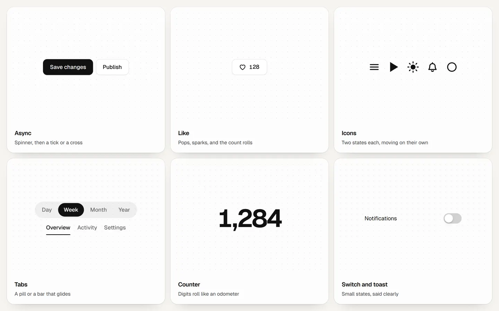

# motion

Small animated details for websites: buttons that answer a press, icons that change state, components that open and slide, and numbers that roll. Plain CSS and TypeScript with no dependencies, so it works in plain HTML, React, Vue, Svelte or anything else.

See [every piece moving on drk.vc](https://drk.vc/repo?id=motion#preview).



| Folder | What is in it |
| --- | --- |
| [`buttons/`](buttons) | Press feedback, an async button (spinner, then a tick or a cross), copy, hold to confirm, and a magnetic lean toward the pointer. |
| [`icons/`](icons) | Ten icons with two states each: menu, play, heart, bell, sun and moon, download, check, eye, arrow and chevron. |
| [`components/`](components) | Switch, tabs with a gliding pill or bar, tooltip, toast, accordion and menu. |
| [`loading/`](loading) | A counter that rolls like an odometer, a spinner, skeletons and a progress bar. |

Most of it is CSS: toggle `aria-pressed` on a button and its icon moves. The script is there for what CSS cannot do alone: timing an async action, holding a press, stacking toasts, rolling digits.

## Install

The package is not on npm. Install it from GitHub, which builds it on the way in:

```bash
npm install github:drkxbt/motion
```

It installs as `@drkxbt/motion`, so it never collides with the popular `motion` package. Import what you need and the stylesheet:

```js
import { asyncButton, icon, toast } from "@drkxbt/motion"; // everything
import { counter } from "@drkxbt/motion/loading"; // or one group
import "@drkxbt/motion/motion.css";
```

## Usage

Every function takes an element you already have and returns a controller with `destroy()`:

```js
const save = document.querySelector("#save");
asyncButton(save, () => fetch("/api/save", { method: "POST" }), { success: "Saved" });

const like = document.querySelector("#like"); // <button aria-pressed="false">
like.prepend(icon("heart"));
like.addEventListener("click", () => like.setAttribute("aria-pressed", String(like.getAttribute("aria-pressed") !== "true")));

toast("Changes saved", { type: "success" });
```

In React, create it in an effect and destroy it on cleanup:

```tsx
function SaveButton({ onSave }: { onSave: () => Promise<void> }) {
  const ref = useRef<HTMLButtonElement>(null);
  useEffect(() => {
    const control = asyncButton(ref.current!, onSave, { success: "Saved" });
    return () => control.destroy();
  }, [onSave]);
  return <button ref={ref} className="m-btn m-btn-primary">Save changes</button>;
}
```

The options and markup for each piece are in its folder: [buttons](buttons#readme), [icons](icons#readme), [components](components#readme), [loading](loading#readme).

## Theming

Colours, durations and curves are custom properties. Set them on `:root` or on any container:

```css
:root {
  --motion-ink: #121212; /* text, outlines, the active tab */
  --motion-surface: #ffffff; /* buttons, menus, toasts */
  --motion-muted: #6b6c70;
  --motion-line: rgb(18 18 18 / 0.12);
  --motion-accent: #121212; /* primary buttons, progress */
  --motion-on-accent: #ffffff;
  --motion-success: #12a150;
  --motion-danger: #e5484d;
  --motion-heart: #f43f5e;
  --motion-radius: 10px;
  --motion-stroke: 2; /* icon stroke width */
  --motion-ease-out: cubic-bezier(0.23, 1, 0.32, 1);
  --motion-ease-in-out: cubic-bezier(0.77, 0, 0.175, 1);
}
```

For a dark theme, swap the ink, surface and accent values. The [demo](demo/demo.css) does it with `[data-theme="dark"]`.

## How it moves

- **Fast.** Interface motion stays under 300ms; a menu opens in 150ms. Things people use many times a day should never make them wait.
- **Out, not in.** Entering and pressing use a strong ease-out, so the first frame already moves. Things moving across the screen ease in and out.
- **Interruptible.** State changes are CSS transitions, so a second click mid-animation turns it around from where it is instead of restarting.
- **From somewhere.** Menus grow out of the corner nearest their button and tooltips out of the side facing their trigger. Nothing scales up from zero.
- **Only transform and opacity** where it can be helped, plus clip-path, blur and stroke drawing where they carry the effect.
- **Reduced motion respected.** With `prefers-reduced-motion`, movement stops and states change at once. Spinners keep turning, slower, since they are the only sign of work.

## Content Security Policy

Nothing in the kit writes a `style` attribute or injects a `<style>` tag: positions and timings are set through the style object, which a strict policy without `'unsafe-inline'` allows. It runs on pages served with `style-src 'self'` and `script-src 'self'`.

## Accessibility

Buttons stay buttons and keep their labels. The async button sets `aria-busy` and stays focusable while it works; results are read out through a polite live region. The switch is `role="switch"` with `aria-checked`, tabs follow the tabs pattern with arrow keys, the menu supports arrow keys, Home, End and Escape, tooltips show on keyboard focus and close on Escape, and hold to confirm accepts a second press from screen readers, which cannot hold.

## Demo

```bash
npm run demo
```

Then open http://localhost:4323/demo/. Everything on the page is live, with a light and a dark theme.

## Tests

```bash
npm test
```

Builds the package and tests the logic that does not need a browser: how digits are keyed and which way they roll, tab keyboard order, the toast stack layout and the spring.

## License

[MIT](LICENSE).
