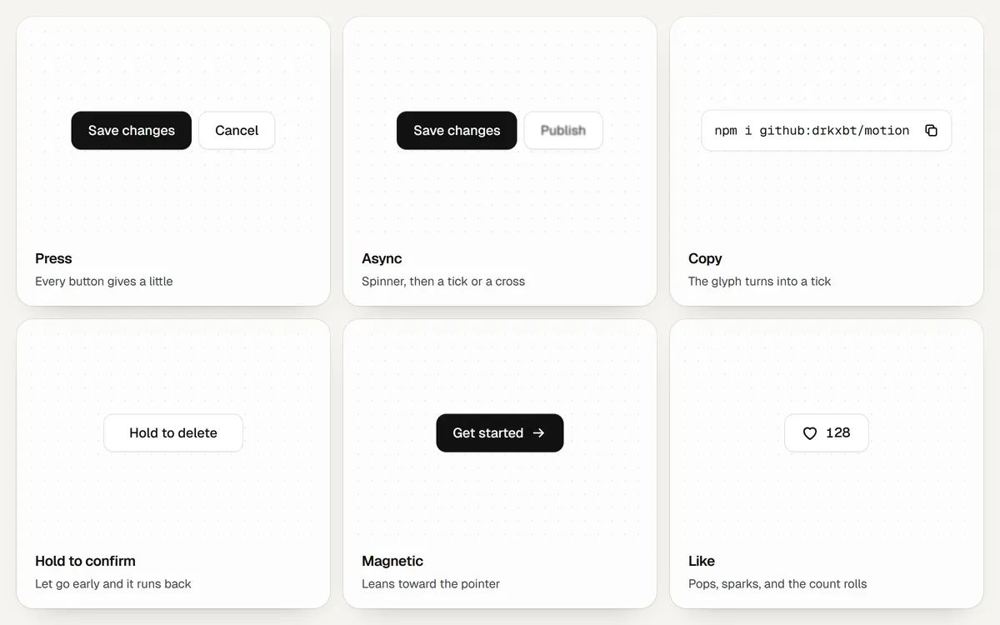

# Buttons



Give any button the `m-btn` class (and `m-btn-primary` for the main action) and it scales to 0.97 while pressed. The functions below add behaviour to a button you already have and keep its markup and label.

```js
import { asyncButton, copyButton, holdButton, magnetic } from "@drkxbt/motion/buttons";
import "@drkxbt/motion/motion.css";
```

## asyncButton(button, action, options)

Runs `action` when clicked and shows what happened: a spinner while it runs, then a tick or a cross, then the label again. The label and the status share one grid cell, so the button never changes width.

```js
asyncButton(document.querySelector("#save"), () => api.save(form), { success: "Saved", error: "No connection" });
```

| Option | Default | |
| --- | --- | --- |
| `success` | `""` | Text beside the tick. Empty shows the tick alone. |
| `error` | `"Something went wrong"` | Text beside the cross, or a function that gets the error. |
| `loading` | `"Working"` | Read to screen readers while it runs. |
| `hold` | `1600` | How long the result stays, in ms. |
| `minimum` | `450` | The shortest time the spinner shows, so a fast action does not flash. |

Returns `{ state, run(), destroy() }`. While busy the button has `aria-busy` and `aria-disabled` but keeps focus.

## copyButton(button, text, options)

Copies `text` (or the result of a function) and turns the copy glyph into a tick for a moment. The button gets `data-copied` meanwhile, so its own styles can respond. A button without an icon gets one.

```js
copyButton(document.querySelector("#copy"), () => location.href, { label: document.querySelector("#copy span") });
```

| Option | Default | |
| --- | --- | --- |
| `copied` | `"Copied"` | Announced, and shown in `label` if given. |
| `failed` | a short instruction | Announced when the clipboard refuses. |
| `duration` | `1500` | How long the tick stays, in ms. |
| `label` | | An element inside the button whose text swaps to `copied`. |
| `icon` | `true` | Adds the copy icon when the button has none. `false` keeps the button's own icon. |
| `onCopy` | | Called after each successful copy. |

## holdButton(button, options)

For actions that should not happen by accident. A fill with the label in inverse colours sweeps across while the button is held; let go early and it runs back. Works with a mouse, a finger, Space or Enter, and a screen reader's click, which cannot be held, asks for a second press instead.

```js
holdButton(document.querySelector("#delete"), { duration: 1200, onConfirm: () => api.remove(id) });
```

The fill colour is `--motion-danger`.

## magnetic(element, options)

The element leans toward the pointer as it comes near and springs back when it leaves. Only with a mouse or trackpad, never under reduced motion.

| Option | Default | |
| --- | --- | --- |
| `strength` | `0.28` | How far it follows, as a share of the pointer's distance from its centre. |
| `reach` | `28` | How far outside the element the pull starts, in px. |
