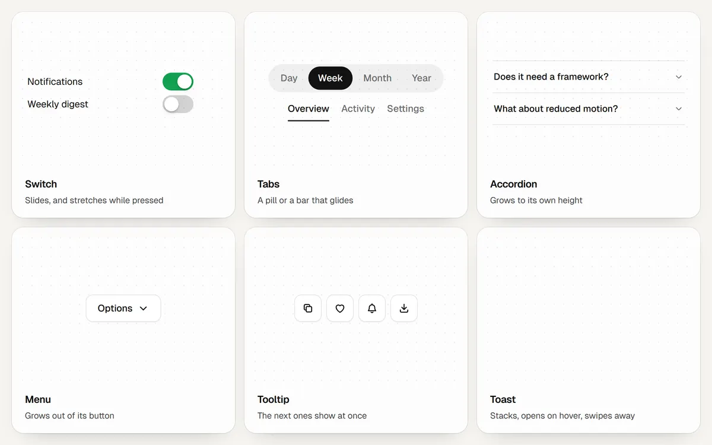

# Components



```js
import { switchControl, tabs, tooltip, toast, accordion, menu } from "@drkxbt/motion/components";
import "@drkxbt/motion/motion.css";
```

## switchControl(button, { onChange })

An on/off switch on a `<button>`. It gets `role="switch"` and `aria-checked`; the thumb slides across and stretches a little while pressed. Returns `{ checked, set(on), destroy() }`.

## tabs(list, options)

A tab list with an indicator that glides between tabs. Give it an element holding buttons; each button's `aria-controls` names its panel, which is hidden while its tab is not selected. Arrow keys, Home and End move between tabs.

| Option | Default | |
| --- | --- | --- |
| `variant` | `"underline"` | `"underline"` slides a bar under the tab; `"pill"` slides a filled pill behind it. The pill is a second, filled copy of the labels clipped to the active tab, so the text colour changes exactly where the pill is, mid-slide included. |
| `activation` | `"auto"` | `"auto"` selects as arrow keys move; `"manual"` waits for Enter or Space. |
| `onChange` | | Called with the new index and tab. |

`slidingIndicator(list, selector)` adds only the gliding bar, for tab lists that already manage their own state. It follows whichever child matches `[aria-selected="true"]` (or your selector).

## tooltip(trigger, options) and tooltips(root)

A short label shown on hover or keyboard focus. The first one waits a moment so passing over a control does not flash it; neighbours shown right after skip the wait and the animation. It grows from the side facing its trigger, flips below when there is no room above, closes on Escape, and never shows for touch. `tooltips()` sets one up for every element with `data-tooltip`. A tooltip that only repeats the trigger's `aria-label` is not linked with `aria-describedby`, so it is not read twice.

## toast(message, options)

A short notice at the edge of the screen. New toasts enter from below; older ones peek out behind the newest, a little smaller each, and the stack opens into a column on hover or focus. The clock stops while the stack is open or the tab is hidden. Drag one down to dismiss it; a quick flick is enough.

```js
toast("Conversation archived", { action: { label: "Undo", onClick: restore } });
toast("Could not reach the server", { type: "error" });
```

| Option | Default | |
| --- | --- | --- |
| `type` | `"info"` | `"info"`, `"success"` or `"error"`. Errors are announced as alerts. |
| `duration` | `4000` | How long it stays, in ms. |
| `action` | | `{ label, onClick }` for one button. |

`configureToasts({ position, visible })` sets `"bottom-center"` or `"bottom-right"` and how many show at once.

## accordion(root, { single })

Sections that open in place. Each `.m-accordion-item` holds a button and the panel after it. The panel grows from nothing to its own height through a grid row, with no height measured in script, and closed panels are inert. With `single`, opening one closes the others.

## menu(trigger, list, { align })

A dropdown menu. Wrap the trigger and the list in an element with the `m-menu` class. It grows out of the corner nearest its trigger and opens in 150ms, because menus are used many times a day. Arrow keys, Home and End move through the items, Escape closes and gives focus back, and a click anywhere else closes it. `align: "end"` lines it up with the trigger's right edge.
