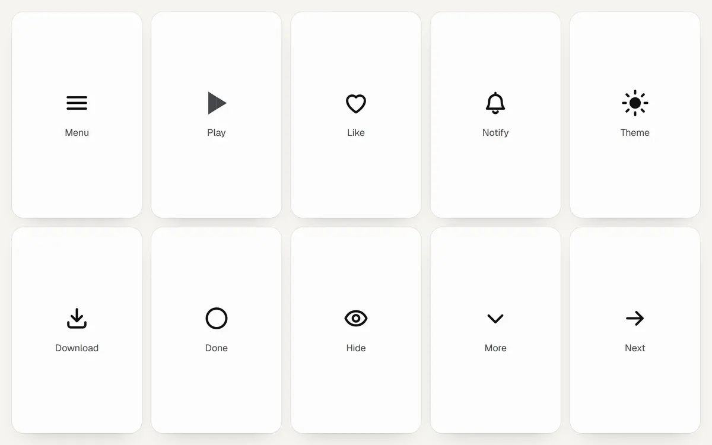

# Icons



Ten icons with two states each. Put one inside a button and toggle the button's `aria-pressed`, `aria-expanded` or `aria-checked`, or set `data-on` on the icon itself. The motion lives in the stylesheet; no script runs after the icon is made.

```js
import { icon, toggle } from "@drkxbt/motion/icons";
import "@drkxbt/motion/motion.css";

const button = document.querySelector("#like"); // <button aria-pressed="false" aria-label="Like">
button.append(icon("heart"));
button.addEventListener("click", () => toggle(button));
```

| Name | Off | On |
| --- | --- | --- |
| `menu` | Three bars | The outer bars cross, the middle one shrinks away. Follows `aria-expanded`. |
| `play` | A triangle | Its halves reshape into two bars. Drawn with clip paths, so it morphs in every browser. |
| `heart` | An outline | Fills, squeezes and pops, with a ring of sparks. |
| `bell` | An outline | Fills and rings once, the clapper lagging behind. |
| `theme` | A sun | The rays fold in while the disc grows and a mask bites a crescent from it. |
| `download` | Arrow over a tray | Set `data-state="loading"` and the arrow bobs; `"done"` drops it into the tray and draws a tick. |
| `check` | A ring | Fills and draws a tick. |
| `eye` | An open eye | A slash draws across it. |
| `arrow` | An arrow | Nudges forward while its link or button is hovered. |
| `chevron` | Pointing down | Turns over. Follows `aria-expanded`. |
| `copy` | Two sheets | Turns into a tick. Used by `copyButton`; follows `data-copied`. |

Icons are decorative (`aria-hidden`), so label the button, not the icon. They draw in `currentColor` with a stroke of `--motion-stroke`.

`ring(bell)` and `burst(heart)` play the animation again while the icon stays on, for a second notification or a second like.
