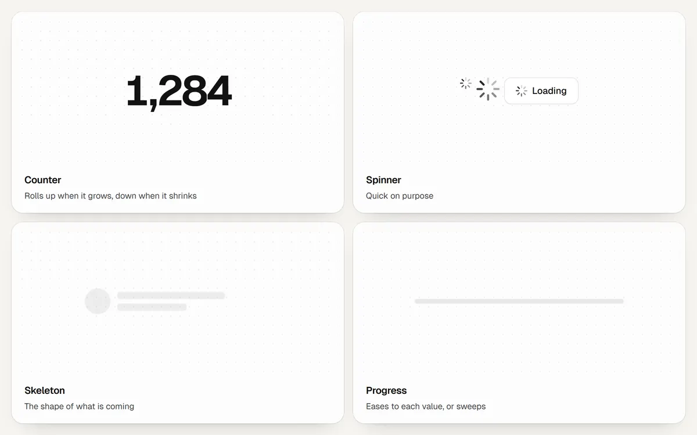

# Loading



```js
import { counter, spinner, progress } from "@drkxbt/motion/loading";
import "@drkxbt/motion/motion.css";
```

## counter(element, options)

A number that rolls to each new value like an odometer: digits roll up when it grows and down when it shrinks, lower places a beat after higher ones. Digits are tabular, so the width only changes when a place is added or removed, and those slots grow in or fold away. Screen readers get the plain formatted number.

```js
const likes = counter(document.querySelector("#likes"), { value: 128 });
likes.set(129);

counter(price, { value: 64012.5, format: { style: "currency", currency: "USD" } });
```

| Option | Default | |
| --- | --- | --- |
| `value` | `0` | The starting value. |
| `format` | `Intl.NumberFormat` defaults | `Intl.NumberFormat` options, or a function from number to text. |
| `locale` | the browser's | For `Intl.NumberFormat`. |

Returns `{ value, set(value), destroy() }`. Values that change faster than a roll lasts finish the last roll at once and start the next.

## spinner(label)

Eight bars that fade in turn, returned as an element with `role="status"`. Quick on purpose: a faster spinner makes the same wait feel shorter. It sizes with `width` and `height` and draws in `currentColor`.

## Skeleton

CSS only. Give a placeholder the `m-skeleton` class (and `m-skeleton-line` for a line of text) in the shape of what is coming, and a soft sheen moves across it. Put `aria-busy="true"` on the region while it loads.

```html
<div aria-busy="true">
  <span class="m-skeleton" style="width: 44px; height: 44px; border-radius: 999px"></span>
  <span class="m-skeleton m-skeleton-line" style="width: 60%"></span>
</div>
```

## progress(element, options)

A progress bar that eases to each new value instead of jumping. `indeterminate()` sweeps a band across for work of unknown length until the next `set`.

| Option | Default | |
| --- | --- | --- |
| `value` | `0` | |
| `max` | `100` | |
| `label` | | The bar's accessible name. |
